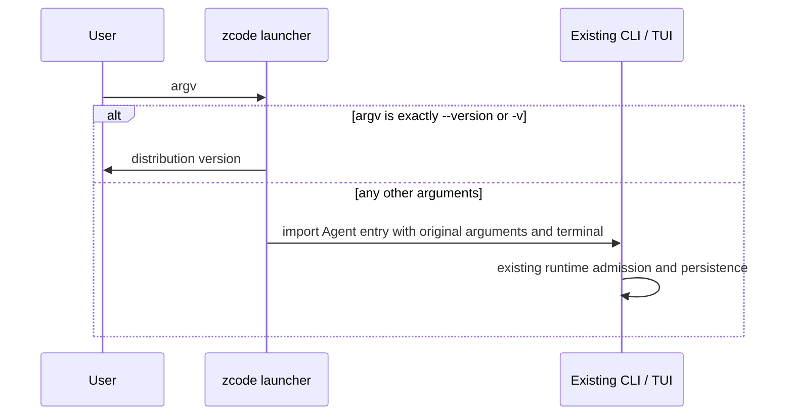

# HCode unified Node distribution

Status: current as of 2026-10-12, after the Web client was removed from the repository
(see `docs/specs/desktop-only-repo-scope.md`).

## Product rules

- The Node distribution is named `zcode`, with executable `bin/zcode.mjs` and installed command
  `zcode`.
- `zcode` starts the existing terminal UI. The launcher special-cases only `--version` and `-v`;
  every other argument is forwarded unchanged to the existing Agent CLI (including `tui`, prompt,
  `login`, resume, `app-server` and internal protocol commands).
- There is no Web mode. A leading `--web` is not special-cased and is forwarded like any other
  argument; the Agent CLI has no `--web` flag. The removed mode started a local HTTP/WebSocket
  server with bundled Web assets (`--workspace`, `--host`, `--port`, `--open`, `--no-open`,
  `--token`, `--no-token`), and it left with `packages/web`, `packages/zcode-server-cli` and the
  Web assets staged into the archive.
- `zcode --help` prints the Agent CLI help, because the launcher forwards `--help`; the
  distribution adds no help text of its own.
- `zcode --version` reports the distribution version from the archive `package.json`, not the
  Agent CLI version.
- TUI inherits the real terminal in the same process; the launcher must not consume its stdin or
  print status.

## Ownership and boundaries

- The release scripts own archive assembly, checksums and installation:
  `scripts/build-zcode.mjs` (assembly), `scripts/zcode-distribution/assets.mjs` (TUI/runtime asset
  staging), `scripts/zcode-distribution/runner.mjs` (launcher source),
  `scripts/zcode-distribution/installer.mjs` (`install.sh` source).
- TUI assets are collected through the CLI's existing `collectSeaTuiAssets` build API; this build
  API is not a new runtime service dependency. Root release scripts are outside the runtime module
  roots in `architecture-policy.yaml`; the referenced CLI module is legacy and has no module
  contract.
- TUI assets are placed under `agent/`, preserving package-relative paths, and the TUI runtime
  dependency closure is copied by the CLI's asset collection. Runtime packages resolved from
  `packages/server/package.json` (`runtimePackageNames`) are copied to the archive root
  `node_modules/`, keeping their dependency versions separate from the TUI assets.
- The CLI's built `provider/` config and `THIRD-PARTY-NOTICES.md` accompany `agent/zcode.cjs`; the
  external Playwright runtime is copied into `agent/node_modules`. Assets for the six SEA targets
  (darwin/linux/win × arm64/x64) are combined; duplicate paths must have identical hashes or
  packaging fails. Required assets are asserted, including with `--skip-build`.
- The launcher imports the existing Agent CLI entry in the same process, setting `process.argv[1]`
  to that entry so self-spawned CLI workers keep using the canonical Agent. It introduces no
  session state, persistence, queue, replay or lease owner, and it starts no child process.

## Packaging and migration

- Build with `pnpm build:zcode`; output is `dist/zcode/`:
  - `releases/<version>/zcode-<version>.tar.gz` — runtime package.
  - `releases/<version>/sha256.txt` — checksum of that tarball.
  - `latest.json` — `baseUrl`, `createdAt`, `name`, `sha256`, `tarball`, `version`.
  - `install.sh` — installer with the download base URL embedded.
- Archive layout: `bin/zcode.mjs`, `agent/zcode.cjs`, `agent/provider/`,
  `agent/THIRD-PARTY-NOTICES.md`, `agent/node_modules/` (TUI runtime), root `node_modules/`
  (runtime packages), and a private `package.json` carrying the version.
- Options: `--skip-build` (reuse the existing Agent build output), `--version <text>` (defaults to
  the root `package.json` version), `--out-dir <path>` (defaults to `dist/zcode`) and
  `--base-url <url>`. An unknown option fails before any build runs.
- Download base URL precedence: `--base-url` overrides `ZCODE_DIST_BASE_URL`, which is read from
  the process environment, then `.env.local`, then `.env`. A missing URL fails before building.
  The installer's own `ZCODE_DIST_BASE_URL` overrides the value embedded in `install.sh`.
- Node remains required, at the version pinned in `mise.toml`. The archive includes TUI assets for
  macOS, Linux and Windows (arm64/x64); native functionality must be verified per platform rather
  than inferred from asset presence.
- Installer behaviour: requires `node`, `curl` and `tar`; installs into `$ZCODE_DIST_HOME`
  (default `~/.zcode/runtime`), keeping `releases/<version>` plus a `current` symlink; writes the
  `zcode` command into `$ZCODE_DIST_BIN_DIR` (default `~/.local/bin`). These release-only variables
  do not change CLI/session data directories, and installation preserves existing user data.
- `pnpm build:lite` no longer exists; there is a single distribution command and output directory.

## Acceptance and validation

1. Launcher routing: exactly `--version` / `-v` prints the distribution version; any other
   argument reaches the Agent CLI unchanged, with the Agent entry as `process.argv[1]` and the real
   terminal inherited.
2. Installer: a local fixture archive proves the installed command is `zcode`, defaults to the CLI,
   and honours `ZCODE_DIST_HOME`, `ZCODE_DIST_BIN_DIR` and `ZCODE_DIST_BASE_URL`.
3. Build URL handling: the build fails before compiling when no base URL is configured, and an
   unknown option fails fast.
4. Distribution smoke: build a real release and verify it outside the repository
   (`node scripts/zcode-distribution-smoke.mjs <archive.tar.gz>`) — isolated data directory, native
   TUI import, initialized render, keyboard exit, no model call.
5. Run root typecheck, lint and architecture checks; report the actual platform and any unexecuted
   cross-platform or model-call paths.

## Known gaps

- The launcher/installer process test (`scripts/zcode-distribution.test.mjs`) was deleted on
  2026-10-12: four of its five cases asserted the removed `zcode --web` mode. Acceptance items 1–3
  currently have no automated in-repo test; the smoke script covers item 4 only when a release
  tarball exists.
- The archive's runtime `node_modules` list is still resolved from `packages/server/package.json`
  and includes HTTP-oriented packages (`@hono/node-server`, `@hono/node-ws`, `yauzl`,
  `node-forge`) that existed for the removed server bundle. Whether the shipped agent runtime still
  needs them was not verified; treat trimming as a separate task.
- `ZCODE_SERVER_HOST`, `PORT`, `ZCODE_SERVER_AUTH_TOKEN`, `ZCODE_SERVER_ID/NAME/TOKEN`,
  `ZCODE_WEB_STATIC_ROOT` and the `@zcode/server` HTTP entry are not part of this distribution.
  They only affect the standalone `pnpm dev:server` entry point.

## Recorded validation (2026-09-20 and 2026-09-24, upstream branches — before Web removal)

Kept for history. The launcher/installer fixtures, the `zcode --web` mode, the Web checks inside
the smoke script, the server build step, `packages/web`, `packages/zcode-server-cli` and
`build:lite` mentioned below no longer exist in this repository.

- `node --test scripts/zcode-distribution.test.mjs`: 5 process/installer tests passed.
- `pnpm build:zcode --base-url …`: complete CLI, server and Web build passed; final assembly was
  repeated with `--skip-build` after adding the CLI sidecar config. Assembly also failed once
  because `@zcode/shared/dist` only exists after root `pnpm typecheck` (`tsc -b` emit), and running
  `pnpm typecheck` after the server build overwrites `packages/server/dist/entry-http.js` with
  unbundled `tsc` output, so the server had to be rebuilt before assembling.
- The server HTTP bundle inlined `yauzl` and crashed on load with a dynamic-require error;
  `yauzl` became an external dependency of `@zcode/server` and is copied into the archive.
- `node scripts/zcode-distribution-smoke.mjs <archive>`: passed on macOS arm64, Node 24.14.0, with
  an isolated data directory; TUI readiness matching strips terminal control sequences because the
  renderer interleaves them between characters.
- Root `pnpm typecheck`, `pnpm lint` and `pnpm architecture:check --changed` passed; lint retained
  pre-existing repository warnings. The third-party notice freshness check passed, but the
  repository still reported 14 pre-existing material-review items, so that was not a strict
  release-compliance approval.
- Cross-platform assets were collected, but Linux, Windows and macOS x64 execution were not tested;
  an authenticated model conversation and browser GUI E2E were outside the packaging smoke test.

## Verification status (2026-10-12, HCode)

- Ran: `node --test scripts/zcode-distribution.test.mjs` before deleting it — 1 passed, 4 failed,
  and all four failures were the removed `--web` cases. This is the evidence behind the deletion.
- Ran: `oxlint` on `packages/server/src/http.ts`, and `oxfmt --check` on `.env.example`,
  `README.en.md` and the specs — clean. `README.md` keeps pre-existing table-alignment drift (it
  also fails on the pre-change revision), so it was not reformatted.
- Not run: `pnpm build:zcode` and `scripts/zcode-distribution-smoke.mjs` (no release tarball; the
  environment had no workspace dependencies and no pnpm, and Node 22 instead of the pinned 24.14.0),
  and `pnpm typecheck` / `pnpm lint` / `pnpm architecture:check` for the same reason. Acceptance
  items 1–5 remain unverified on this branch and must be re-run on a full toolchain before release.
